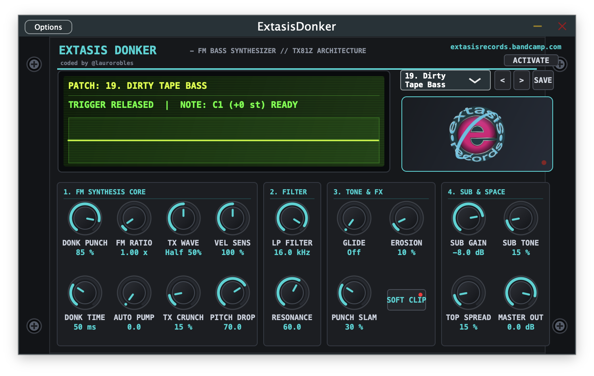

# 🪵 EXTASIS MARIMBA
### Free & Open-Source Mexican Physical-FM Synthesizer (VST3 / AU / Standalone)
**Developed & Coded by [@laurorobles](https://github.com/laurorobles) // [Extasis Records](https://extasisrecords.bandcamp.com)**

[](LICENSE)
[](https://github.com/laurorobles/ExtasisMarimba/releases/latest)
[](https://github.com/laurorobles/ExtasisMarimba/releases/latest)
[](https://github.com/laurorobles/ExtasisMarimba/releases/latest)
[](TECHNICAL.md)

<p align="center">
  
</p>

---

## 🌟 Overview

**Extasis Marimba** is a **100% free and open-source** (GPLv3), CPU-efficient virtual synthesizer designed to capture the exact acoustic physics, timbral nuance, and unmistakable percussive soul of the **traditional Mexican marimba (Marimba Chiapaneca / Oaxaqueña)**.

Unlike heavy sample libraries that rely on static velocity layers, **Extasis Marimba** synthesizes every strike in real time from the ground up using a custom, lock-free C++ **Physical-FM & Acoustic Resonator Engine**. No samples, no DRM, no nag screens, no time limits—just pure mathematical acoustics in a sub-15MB package.

---

## ✨ Comprehensive Feature List

### 🪵 1. The Wooden Bar (Tuned 1:4:10 FM Mode Synthesis)
* **1:4:10 Tuned Mode Mathematics:** Standard uniform wood bars vibrate at dissonant ratios (1:2.76:5.4). Real Mexican marimbas are hand-carved underneath to tune these upper modes to a 1:4:10 relationship (Fundamental, 2 Octaves, and 3 Octaves + Major Third). Our FM core faithfully models this artisanal carving with Nyquist-safe upper mode handling.
* **Dynamic Exponential Velocity Mapping:** Soft strikes produce a warm, pure fundamental tone; hard strikes unleash rich FM energy and percussive bite, mirroring how real *Hormiguillo* wood responds to mallet force.
* **Stick Transient (Click / Snap):** A dedicated 5-millisecond high-pass filtered noise generator (2.5 kHz) reproduces the raw *"TAK"* of rubber and wooden mallets striking the bar.

### 🏺 2. The Resonator Tube & Acoustic Interaction
* **20ms Acoustic Distance Delay:** Models the physical time sound takes to travel from the wooden bar down into the resonator tube (*"TAK → TANG → BOONG"*).
* **1/4-Wave Tube Cavity:** A narrow resonant bandpass filter (Q = 15.0) strictly key-tracked to the fundamental frequency, recreating the hollow acoustic bloom of the wooden *cajón*.
* **Aggressive Key-Tracked Decay:** Physically models bar mass—massive bass bars ring out with rich sustain, while tiny treble bars snap and decay rapidly.

### 🐝 3. La Cachimba (The Membrane Buzz)
* **Dynamic Charleo Engine:** Models the traditional pig-intestine membrane (*tela de tripa de cerdo*) affixed with beeswax at the base of the resonator.
* **Pressure-Threshold Gating:** The *Charleo* rattles only when acoustic pressure inside the tube exceeds the velocity threshold set by `BUZZ DYNAMICS`, producing the authentic *«ÑAAANG–BRR»* texture on accents.

### 🏘️ 4. The Environment (Artisanal Imperfection & Expressive Playability)
* **Organic "Pueblo" Drift:** Deterministic per-key randomization introduces permanent, unique micro-detuning (±8 cents), tube variance, and decay shifts per MIDI note, plus subtle per-strike variation so no two hits sound digitally identical.
* **Equal-Power Acoustic Stereo Panning:** Maps low bars to the left and high bars to the right with balanced equal-power laws, scalable via `SPREAD`.
* **Decorrelated Stereo Ambience:** Dual-channel courtyard/floor reflections with asymmetric tap times and cross-feedback keep the stereo field wide and natural.
* **Full MIDI Expressiveness:** 16-voice polyphony with quietest-voice stealing, Sustain Pedal (CC 64), and Pitch Bend (±2 semitones).
* **Master Soft Saturation:** Subtle `std::tanh` analog-style saturation glues transient snap and tube bloom together.

### 🎛️ 5. Studio-Grade User Experience (v4.0 GUI)
* **12 Musical Physical Controls:** *Hardness, Overtones, Material, Click/Snap, Tube Cavity, Bar Decay, Membrane Buzz, Buzz Dynamics, Organic Drift, Ambience, Spread, and Master Vol* — all supporting **double-click to reset**.
* **Lock-Free Real-Time LCD Dashboard:** Zero-allocation audio-to-UI ring buffer powering a live oscilloscope, active voice counter (`VOICES X/16`), and dynamic `1:4:10` / `TUBE` / `BUZZ` energy meters.
* **Quick Patch Tools:** One-click **`INIT`** (clean concert marimba) and **`RND`** (musically constrained patch randomizer) right in the header, plus **`SAVE`** for custom `.empreset` user patches.
* **Interactive Extasis Logo Trigger Pad:** Click to audition and drag vertically (±24 semitones) with a live pitch readout badge (`PAD: C4`).
* **40 Categorized Factory Presets:**
  * *Traditional Mexican & Chiapaneca (01 – 10)*
  * *Latin Club, Cumbia & Bass (11 – 20)*
  * *Concert, Acoustic & Traditional World (21 – 30)*
  * *Experimental, Glass & Hybrid FM (31 – 40)*

---

## 🚀 Quick Installation

Download the latest free binaries from the **[GitHub Releases Page](https://github.com/laurorobles/ExtasisMarimba/releases/latest)**:

### macOS (Apple Silicon & Intel)
1. Download `ExtasisMarimba-macOS.zip` and extract it.
2. Run `install_mac.sh` or manually copy:
   * **VST3:** `~/Library/Audio/Plug-Ins/VST3/Extasis Marimba.vst3`
   * **AU:** `~/Library/Audio/Plug-Ins/Components/Extasis Marimba.component`
   * **Standalone:** `/Applications/Extasis Marimba.app`

### Windows (64-bit)
1. Download `ExtasisMarimba-Windows.zip` and extract it.
2. Run `install_windows.bat` or copy `Extasis Marimba.vst3` to `C:\Program Files\Common Files\VST3\`.

### Linux (x64)
1. Download `ExtasisMarimba-Linux.zip` and extract it.
2. Run `installer/INSTALL_LINUX.sh` or copy `Extasis Marimba.vst3` to `~/.vst3/`.

---

## 🛠️ Building from Source

### Prerequisites
* **CMake** (>= 3.15)
* **C++17** compatible compiler (Clang / AppleClang / GCC / MSVC)
* **JUCE 8** (Automatically downloaded via CMake `FetchContent` if not installed locally)

### Build Commands
```bash
git clone https://github.com/laurorobles/ExtasisMarimba.git
cd ExtasisMarimba

cmake -B build -DCMAKE_BUILD_TYPE=Release
cmake --build build --config Release --parallel
```

---

## ⚖️ License & Contributing

**Extasis Marimba** is **Free and Open Source Software** licensed under the **[GNU General Public License v3.0 (GPLv3)](LICENSE)**.  
Contributions, bug reports, pull requests, and community presets are welcome!

If you enjoy this instrument and want to support independent Mexican audio software development, feel free to star the repo or check out **[Extasis Records on Bandcamp](https://extasisrecords.bandcamp.com)**.

---
*© 2026 Lauro Robles / Extasis Records — Made with ❤️ in Mexico.*
